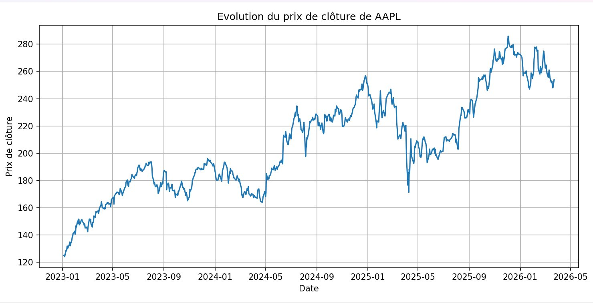
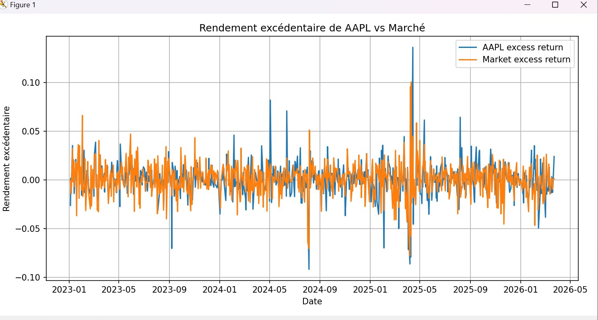
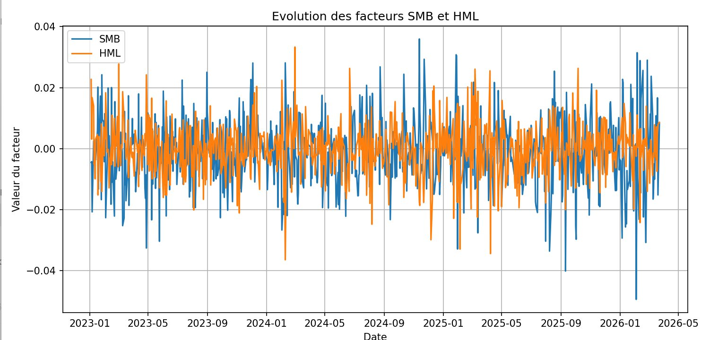
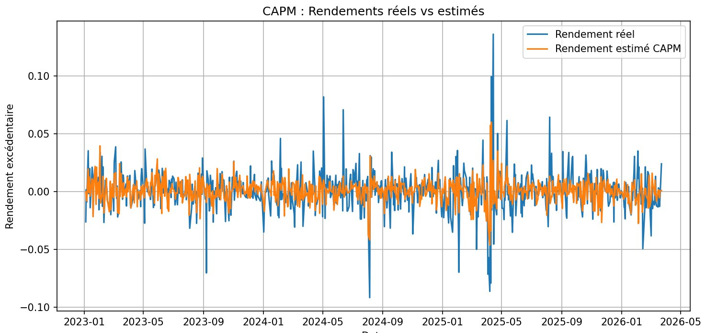
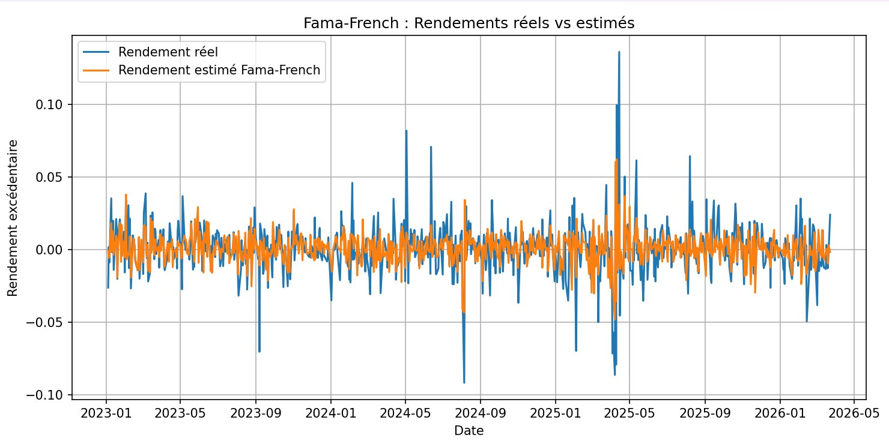

# Modélisation Factorielle & Économétrie des Séries Temporelles : CAPM vs Fama-French 3 Facteurs

Implémentation empirique complète et évaluation comparative entre le modèle unifactoriel **CAPM** (*Capital Asset Pricing Model*, Sharpe 1964) et le modèle multifactoriel de **Fama-French à 3 facteurs** (1993) sur un panel de **30 actions technologiques américaines** (NASDAQ / NYSE) couvrant **806 observations journalières** (janvier 2023 – mars 2026)[cite: 15].

---

## 1. Contexte & Cadre Expérimental

L'objectif de ce projet est d'expliquer la dynamique des rendements excédentaires de l'action **AAPL (Apple Inc.)** en décomposant son exposition au risque systématique de marché ainsi qu'à deux facteurs latents (taille et valeur) construits à partir de l'univers des 30 titres[cite: 15].

| Paramètre du Pipeline | Spécification Technique |
| :--- | :--- |
| **Période d'étude** | 04/01/2023 – 03/2026 (806 jours de cotation)[cite: 15] |
| **Univers d'investissement** | 30 actions technologiques (NASDAQ / NYSE)[cite: 15] |
| **Actif cible modélisé** | AAPL (Apple Inc.)[cite: 15] |
| **Taux sans risque ($R_f$)** | $3\ \%/\text{an} \rightarrow 0.00011905/\text{jour}$ (base 252 jours)[cite: 15] |
| **Portefeuille de marché ($R_m$)** | Moyenne arithmétique équipondérée des 30 rendements journaliers[cite: 15] |
| **Construction SMB / HML** | Partition médiane (50/50) sur le *Market Cap* et le ratio *Book-to-Market*[cite: 15] |
| **Estimateur OLS (Fama-French)** | Résolution matricielle $\hat{\beta} = (X'X)^{-1}X'Y$ avec $X \in \mathbb{R}^{806 \times 4}$ et $Y \in \mathbb{R}^{806 \times 1}$[cite: 15] |

---

## 2. Pipeline de Feature Engineering & Modélisation

1. **Calcul des rendements & excès de rendement :**
   $$R_{i,t} = \frac{\text{Close}_t - \text{Close}_{t-1}}{\text{Close}_{t-1}}, \quad R_{i,\text{excès}} = R_i - R_{f,\text{jour}}$$[cite: 15]
2. **Facteur Taille — SMB (*Small Minus Big*) :** Classement journalier par capitalisation boursière autour de la médiane :
   $$\text{SMB}(t) = \overline{R}_{\text{small}}(t) - \overline{R}_{\text{big}}(t)$$[cite: 15]
3. **Facteur Valeur — HML (*High Minus Low*) :** Classement journalier par ratio $\text{BM} = \text{Book Value} / \text{Close}$ :
   $$\text{HML}(t) = \overline{R}_{\text{high\_BM}}(t) - \overline{R}_{\text{low\_BM}}(t)$$[cite: 15]
4. **Spécification Économétrique (FF3) :**
   $$R_i - R_f = \alpha + \beta (R_m - R_f) + s \cdot \text{SMB} + h \cdot \text{HML} + \varepsilon$$[cite: 15]

---

## 3. Résultats Empiriques & Comparaison Statistique

| Métrique / Coefficient | CAPM (1 Facteur) | Fama-French 3F | Écart | Interprétation Statistique & Économique |
| :--- | :---: | :---: | :---: | :--- |
| **Alpha journalier ($\alpha$)** | $+0.000216$[cite: 15] | $-0.000050$[cite: 15] | $-0.000266$[cite: 15] | Absorption de la surperformance apparente par SMB/HML[cite: 15] |
| **Alpha annualisé** | $+5.44\ \%/\text{an}$[cite: 15] | $-1.26\ \%/\text{an}$[cite: 15] | $-6.70\ \text{pp}$[cite: 15] | Résidu non significatif sous contrôle multifactoriel[cite: 15] |
| **Beta marché ($\beta$)** | $0.5949$[cite: 15] | $0.6046$[cite: 15] | $+0.0097$[cite: 15] | Profil défensif ($\beta < 1$), résilience des revenus récurrents[cite: 15] |
| **Sensibilité Taille ($s$ — SMB)** | —[cite: 15] | $-0.2086$[cite: 15] | —[cite: 15] | $s < 0$ : comportement typique d'une *Mega-Cap*[cite: 15] |
| **Sensibilité Valeur ($h$ — HML)** | —[cite: 15] | $-0.0538$[cite: 15] | —[cite: 15] | $h < 0$ : signature d'une valeur *Growth* (BM faible $\approx 0.047$)[cite: 15] |
| **Coefficient $R^2$** | **$0.3239$**[cite: 15] | **$0.3412$**[cite: 15] | **$+1.73\ \text{pp}$**[cite: 15] | **Gain de pouvoir explicatif ($34.1\ \%$ vs $32.4\ \%$)**[cite: 15] |

---

## 4. Visualisations & Analyse Graphique

### 4.1 Dynamique du cours de clôture de AAPL (2023–2026)

*Progression du titre d'environ 125 $ à 250 $ (+100 %) sur la période étudiée.*[cite: 15]

### 4.2 Rendements excédentaires journaliers : AAPL vs Marché

*Forte co-variation positive entre l'actif cible et le portefeuille équipondéré des 30 valeurs technologiques.*[cite: 15]

### 4.3 Évolution journalière des facteurs latents SMB et HML

*Stationnarité des primes de risque autour de zéro (amplitude $\pm 3\ \%$) capturant les rotations sectorielles taille et valeur.*[cite: 15]

### 4.4 Ajustement du modèle CAPM (Réels vs Estimés)

*Lissage des variations extrêmes par le facteur unique de marché ($R^2 = 0.3239$).*[cite: 15]

### 4.5 Ajustement du modèle Fama-French 3 Facteurs (Réels vs Estimés)

*Meilleure capture de la variance systématique grâce à l'ajout des facteurs SMB et HML ($R^2 = 0.3412$).*[cite: 15]

---

## 5. Stack Technique & Références

* **Langage & Calcul Scientifique :** Python, NumPy (algèbre linéaire matricielle), Pandas (manipulation de séries temporelles)[cite: 15].
* **Visualisation :** Matplotlib[cite: 15].
* **Références Académiques :**
  * Fama, E. F., & French, K. R. (1993). *Common risk factors in the returns on stocks and bonds*. Journal of Financial Economics, 33(1), 3–56[cite: 15].
  * Sharpe, W. F. (1964). *Capital asset prices: A theory of market equilibrium under conditions of risk*. Journal of Finance, 19(3), 425–442[cite: 15].
